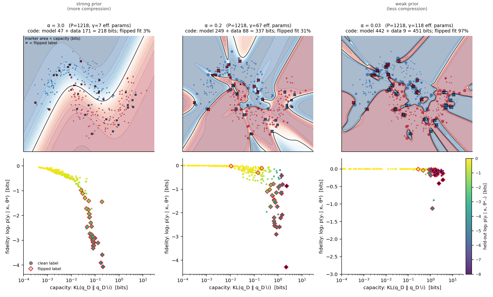

# capfid

[](https://github.com/maomlab/capfid/actions/workflows/tests.yml)
[](LICENSE)

**Per-example model capacity versus fidelity for PyTorch models.**

How many bits of a trained network's capacity does each training example cost, and how well
is that example fit? `capfid` answers this for every training example, and for any set of
examples, by measuring how much a linearized Laplace posterior over the weights changes when
the example is *unlearned*.

**Manuscript:** *How Many Bits Does a Training Example Cost? Per-Example Capacity versus
Fidelity via Linearized Laplace Unlearning*. [PDF](paper/capacity_fidelity.pdf) (preprint;
arXiv link to follow). Every figure and table can be regenerated with
[`examples/paper/reproduce_paper.py`](examples/paper/reproduce_paper.py).



## What it computes

For a network trained to a MAP estimate θ* of `Σᵢ ℓ(yᵢ, f(xᵢ; θ)) + (α/2)‖θ‖²`, capfid builds
the linearized Laplace (generalized Gauss–Newton) posterior q_D = N(θ*, Σ) and asks what
happens when an example i is removed:

| key | quantity | meaning |
|---|---|---|
| `dof` | tr Kᵢ | effective number of parameters the example determines (sums to MacKay's γ) |
| `volume_bits` | h(θ\|D∖i) − h(θ\|D) | weight-space volume the example pins down; label-agnostic capacity |
| `information_bits` | KL(q_D ‖ q_D∖i) | information the weights actually store about (xᵢ, yᵢ) |
| `fidelity_bits` | log₂ p(yᵢ \| xᵢ, θ*) | how well the trained model fits the example |
| `heldout_fidelity_bits` | log₂ p(yᵢ \| xᵢ, θ*₋ᵢ) | fit after unlearning the example (one Newton step) |
| `memorization_bits` | fidelity − held-out | how much the fit depends on having seen the example |

All of these reduce exactly to C × C matrices at each example (C = number of outputs), so
every example is scored after one Cholesky factorization. Under exact Bayesian updating,
`information_bits` equals the example's generalization gap, and in linear regression
`volume_bits` is the classical leverage formula −½ log₂(1 − hᵢᵢ). See the manuscript for
derivations.

## Install

```bash
pip install git+https://github.com/maomlab/capfid.git

# with plotting and the example dependencies
pip install "capfid[examples] @ git+https://github.com/maomlab/capfid.git"

# development
git clone https://github.com/maomlab/capfid.git && cd capfid
pip install -e ".[dev]"
pytest
```

Requires Python ≥ 3.9 and PyTorch ≥ 2.0. A CPU-only PyTorch build is sufficient.

## Quickstart

```python
import capfid

# model: trained on  Σ_i loss_i + (alpha/2)||θ||²  (see "Using it on your own model")
la = capfid.LinearizedLaplace(model, X, y, capfid.Categorical(), prior_precision=alpha)

res = la.pointwise()               # dict of per-example numpy arrays
# pandas.DataFrame(res).sort_values("information_bits", ascending=False).head()

la.set_capacity(indices)           # joint capacity of a subset, incl. its redundancy ratio
la.totals()                        # effective params, model information, MDL code length

from capfid.plotting import capacity_fidelity_plot
capacity_fidelity_plot(res, highlight=suspected_label_errors)
```

[`examples/quickstart.py`](examples/quickstart.py) runs end to end in about 10 seconds on a CPU
(two moons with 10% flipped labels). On that example the flipped labels cost a median of
0.47 bits each versus 0.01 bits for clean ones.

## Using it on your own model

1. **Match the objective.** `prior_precision` is α in a *summed* loss plus (α/2)‖θ‖². If you
   trained on a mean loss with coupled weight decay λ (SGD or Adam `weight_decay`), use
   `capfid.prior_precision_from_weight_decay(λ, n_train)`, i.e. α = N·λ. AdamW's decoupled
   decay is only approximately equivalent.
2. **Start near a stationary point.** Unlearning uses one Newton step, which assumes the
   gradient is about zero. A few L-BFGS iterations help:
   `capfid.train_map(model, X, y, lik, alpha, adam_steps=0, lbfgs_iters=100)`.
3. **Examples must be processed independently.** The model is put in eval mode; avoid
   batch norm in training mode.
4. **Size.** The exact posterior needs about 8P² bytes and O(P³) time, which is practical up
   to roughly P = 2 × 10⁴ parameters. For larger models, restrict the posterior to a subset,
   for example the last layer:
   `LinearizedLaplace(..., param_filter=lambda name: name.startswith("head"))`.
5. **Likelihoods.** `Categorical()` takes class indices; `Gaussian(sigma)` takes targets
   shaped like the outputs. For others, subclass `capfid.Likelihood` and implement
   `log_lik` and `grad_hess`.

## Reading the capacity–fidelity plot

- **Typical:** low capacity, high fidelity, held-out ≈ fidelity.
- **Memorized:** high capacity, high fidelity, low held-out fidelity (for example, fitted label noise).
- **Ignored:** modest capacity, low fidelity (examples the model does not explain).
- **Atypical but correct:** elevated capacity, high fidelity (long-tail examples).

## Limitations

- The posterior is local to one basin and ignores the implicit regularization of stochastic
  training; capacities are defined relative to the prior precision α.
- One-step unlearning is accurate for typical examples but overestimates the effect of
  removing heavily memorized ones (by several-fold in the manuscript's transformer
  experiment). Use capacity as a ranking and held-out fidelity as qualitative there; joint
  information for large sets inherits this.
- For confident classifiers at weak priors, posterior-averaged fidelities
  (`expected_fidelity_bits`) are pessimistic. Plug-in fidelity and the capacity measures are
  unaffected.

## Reproducing the manuscript

```bash
pip install -e ".[examples]"
python examples/paper/reproduce_paper.py --out paper/figures          # ~12 min, one CPU core
python examples/paper/reproduce_paper.py --quick --out /tmp/figures   # ~1 min smoke test
```

The LaTeX source is in [`paper/`](paper/).

## Tests

`pytest` runs 16 tests, including exact checks against brute-force leave-one-out refits in
Bayesian linear regression (information, held-out likelihood, the Bayes identity, the leverage
formula, and the Newton step) and structural checks on a nonlinear classifier (leverage
eigenvalues in [0, 1), Σ dof = γ, joint volume ≥ sum of single volumes, code-length identities).

## Citation

If you use capfid, please cite the manuscript (see also [`CITATION.cff`](CITATION.cff)):

```bibtex
@misc{capfid2026,
  title  = {How Many Bits Does a Training Example Cost? Per-Example Capacity versus
            Fidelity via Linearized Laplace Unlearning},
  author = {O'Meara, Matthew},
  year   = {2026},
  note   = {Preprint. Code: \url{https://github.com/maomlab/capfid}}
}
```

## License

MIT. See [LICENSE](LICENSE).
